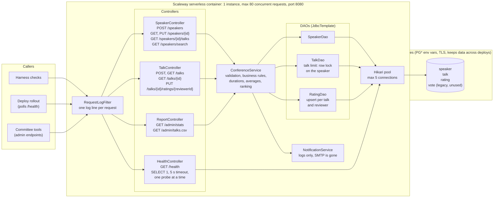
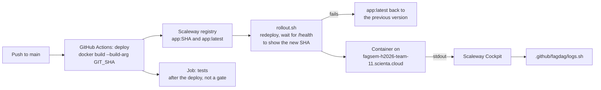

# Architecture

The CFP backend is one Spring Boot 2.7 service (Java 17) with one Postgres database. It runs as one
Scaleway serverless container. The code is in one package, `no.scienta.cfp`, in three layers:
controllers, one service and DAOs on `JdbcTemplate`. There is no JPA.

## Runtime

## Deploy and logs

## Facts that matter when you change the code

- `schema.sql` runs on every start-up (`spring.sql.init.mode=always`). Each statement must be
  idempotent (`IF NOT EXISTS`). Add new statements at the bottom.
- The talk limit holds under concurrent requests because `TalkDao.insertIfBelow` locks the speaker
  row (`SELECT … FOR UPDATE`) in the service transaction. Advisory locks are not available.
- A rating is one `INSERT … ON CONFLICT DO UPDATE`, so a double-click cannot count twice.
- `averageRating` and `ratingCount` come from one query per talk. `GET /talks` makes 1 + N queries.
- `ratedAtDisplay` uses the explicit pattern `M/d/yy, h:mm a` with `Locale.US`. Do not use the
  locale's SHORT style: from Java 20 it puts a narrow no-break space before AM/PM.
- `/admin/*` and `/speakers/search` are not in the specs. `/speakers/search` builds its SQL with
  string concatenation.
